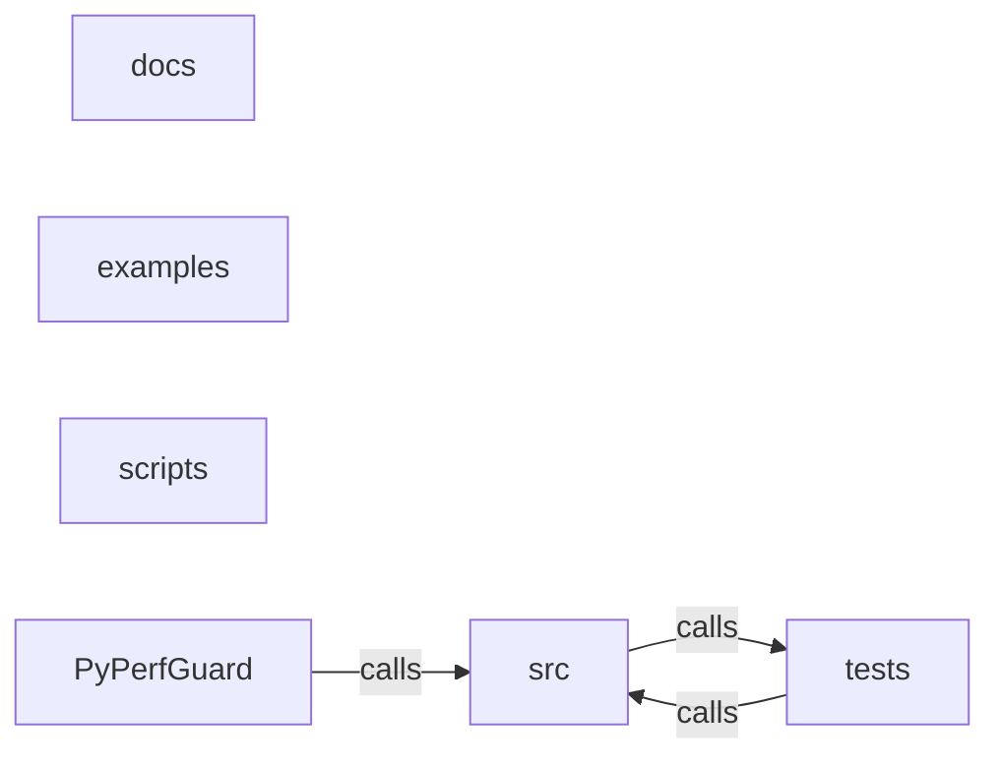

_Generated by CodeAtlas._

## Details

Architecture map of PyPerfGuard.

### docs

Owns 0 symbols across 4 file(s).

**Related Classes/Methods:** _None_

### examples

Owns 0 symbols across 1 file(s).

**Related Classes/Methods:** _None_

### scripts

Owns 0 symbols across 1 file(s).

**Related Classes/Methods:** _None_

### src

Owns 303 symbols across 18 file(s).

**Related Classes/Methods:** _None_

**Source Files:**

- `src/baseline.rs`
  - `src.baseline.BaselineEntry`
  - `src.baseline.BaselineManager`
  - `src.baseline.BaselineManager.clear`
  - `src.baseline.BaselineManager.get`
  - `src.baseline.BaselineManager.list`
  - `src.baseline.BaselineManager.load_baseline_entry`
  - `src.baseline.BaselineManager.load_registry`
  - `src.baseline.BaselineManager.new`
  - `src.baseline.BaselineManager.register`
  - `src.baseline.BaselineManager.register_file`
  - `src.baseline.BaselineManager.register_latest`
  - `src.baseline.BaselineManager.registry_path`
  - `src.baseline.BaselineManager.save_registry`
  - `src.baseline.BaselineManager.select`
  - `src.baseline.BaselineManager.store`
  - `src.baseline.BaselineSelection`
  - `src.baseline.BaselinesFile`
  - `src.baseline.tests.clear_removes_entry`
  - `src.baseline.tests.manager`
  - `src.baseline.tests.register_and_get`
  - `src.baseline.tests.result`
  - `src.baseline.tests.select_by_revision`
  - `src.baseline.tests.select_latest`
  - `src.baseline.tests.select_missing_revision_errors`
  - `src.baseline.tests.select_none_returns_none`
- `src/cli.rs`
  - `src.cli.BaselineAction`
  - `src.cli.BaselineArgs`
  - `src.cli.BenchSelectArgs`
  - `src.cli.CheckArgs`
  - `src.cli.Cli`
  - `src.cli.Command`
  - `src.cli.CompareArgs`
  - `src.cli.Format`
  - `src.cli.HistoryArgs`
  - `src.cli.InitArgs`
  - `src.cli.ReportArgs`
  - `src.cli.RunArgs`
  - `src.cli.ValidateArgs`
- `src/commands.rs`
  - `src.commands.CheckOutput`
  - `src.commands.ValidationItem`
  - `src.commands.append_to_file`
  - `src.commands.base_dir`
  - `src.commands.baseline_cmd`
  - `src.commands.check`
  - `src.commands.choose_baseline`
  - `src.commands.combine_exit`
  - `src.commands.compare_cmd`
  - `src.commands.cwd`
  - `src.commands.dispatch`
  - `src.commands.doctor`
  - `src.commands.emit`
  - `src.commands.history_cmd`
  - `src.commands.init`
  - `src.commands.load_config`
  - `src.commands.minimal_loaded`
  - `src.commands.parse_metrics`
  - `src.commands.policy_with_flags`
  - `src.commands.report_cmd`
  - `src.commands.resolve_result`
  - `src.commands.run`
  - `src.commands.runner_options`
  - `src.commands.store_for`
  - `src.commands.trend_points`
  - `src.commands.validate_cmd`
  - `src.commands.version`
- `src/compare.rs`
  - `src.compare.Comparison`
  - `src.compare.Comparison.metric`
  - `src.compare.MetricComparison`
  - `src.compare.MetricComparison.significantly_different`
  - `src.compare.compare`
  - `src.compare.tests.detects_pct_increase`
  - `src.compare.tests.incompatible_when_ids_differ`
  - `src.compare.tests.records_environment_caveat`
  - `src.compare.tests.result`
  - `src.compare.tests.zero_baseline_yields_no_pct`
- `src/config.rs`
  - `src.config.BenchmarkConfig`
  - `src.config.Config`
  - `src.config.LoadedConfig`
  - `src.config.LoadedConfig.benchmark`
  - `src.config.LoadedConfig.discover`
  - `src.config.LoadedConfig.from_str`
  - `src.config.LoadedConfig.load`
  - `src.config.LoadedConfig.output_dir`
  - `src.config.LoadedConfig.resolve_cwd`
  - `src.config.LoadedConfig.validate`
  - `src.config.MeasureConfig`
  - `src.config.MeasureConfig.default`
  - `src.config.OutputConfig`
  - `src.config.OutputConfig.default`
  - `src.config.OutputMode`
  - `src.config.PolicyConfig`
  - `src.config.ProjectConfig`
  - `src.config.ProjectConfig.default`
  - `src.config.Severity`
  - `src.config.Threshold`
  - `src.config.default_capture_limit`
  - `src.config.default_metrics`
  - `src.config.default_output_dir`
  - `src.config.default_project_name`
  - `src.config.default_repetitions`
  - `src.config.default_retain`
  - `src.config.default_warmups`
  - `src.config.starter_config`
  - `src.config.tests.parses_minimal_config`
  - `src.config.tests.rejects_duplicate_ids`
  - `src.config.tests.rejects_empty_command`
  - `src.config.tests.rejects_threshold_without_bounds`
  - `src.config.tests.rejects_unknown_fields`
  - `src.config.tests.rejects_zero_repetitions`
  - `src.config.tests.severity_ordering`
  - `src.config.tests.starter_config_is_valid`
- `src/error.rs`
  - `src.error.Error`
  - `src.error.Error.exit_code`
  - `src.error.Error.io`
  - `src.error.ExitCode`
  - `src.error.ExitCode.fmt`
  - `src.error.tests.errors_map_to_documented_exit_codes`
- `src/git.rs`
  - `src.git.current_revision`
  - `src.git.git`
  - `src.git.is_ancestor`
  - `src.git.is_repo`
  - `src.git.is_shallow`
  - `src.git.resolve`
  - `src.git.short_sha`
  - `src.git.tests.non_repo_returns_default_revision`
  - `src.git.tests.short_sha_truncates`
- `src/main.rs`
  - `src.main.init_tracing`
  - `src.main.main`
- `src/metric.rs`
  - `src.metric.Metric`
  - `src.metric.Metric.all`
  - `src.metric.Metric.lower_is_better`
  - `src.metric.Metric.name`
  - `src.metric.Metric.parse`
  - `src.metric.Metric.unit`
  - `src.metric.tests.aliases_parse`
  - `src.metric.tests.names_round_trip`
- `src/policy.rs`
  - `src.policy.MetricOutcome`
  - `src.policy.Outcome`
  - `src.policy.Outcome.label`
  - `src.policy.Outcome.rank`
  - `src.policy.PolicyReport`
  - `src.policy.PolicyReport.blocks`
  - `src.policy.PolicyReport.exit_code`
  - `src.policy.evaluate`
  - `src.policy.severity_outcome`
  - `src.policy.tests.block_time_pct`
  - `src.policy.tests.exceeding_block_threshold_is_regression`
  - `src.policy.tests.min_repetitions_inconclusive`
  - `src.policy.tests.missing_current_measurement_is_error`
  - `src.policy.tests.no_baseline_is_inconclusive`
  - `src.policy.tests.noise_tolerance_suppresses_marginal_regression`
  - `src.policy.tests.result`
  - `src.policy.tests.significance_requirement_downgrades_unsubstantiated`
  - `src.policy.tests.unsubstantiated_breach_becomes_warning`
  - `src.policy.tests.warn_severity_does_not_block`
  - `src.policy.tests.within_threshold_passes`
  - `src.policy.tests.zero_baseline_pct_threshold_inconclusive`
- `src/process.rs`
  - `src.process.CommandSpec`
  - `src.process.RawRun`
  - `src.process.RawRun.cpu_ms`
  - `src.process.RawRun.success`
  - `src.process.decode_status`
  - `src.process.imp.execute`
  - `src.process.imp.maxrss_to_bytes`
  - `src.process.imp.read_limited`
  - `src.process.imp.signal_child`
  - `src.process.imp.stdio_for`
  - `src.process.imp.timeval_ms`
  - `src.process.supports_process_rusage`
  - `src.process.tests.capture_limit_bounds_output`
  - `src.process.tests.captures_nonzero_exit`
  - `src.process.tests.captures_stdout`
  - `src.process.tests.decode_status_encodes_exit_and_signal`
  - `src.process.tests.runs_true_like_command`
  - `src.process.tests.spawn_failure_is_execution_error`
  - `src.process.tests.spec`
  - `src.process.tests.timeout_terminates_long_run`
- `src/report.rs`
  - `src.report.TrendPoint`
  - `src.report.canvg_line`
  - `src.report.comparison_csv`
  - `src.report.csv_trend`
  - `src.report.direction`
  - `src.report.fmt_bytes`
  - `src.report.fmt_change_abs`
  - `src.report.fmt_metric`
  - `src.report.fmt_pct`
  - `src.report.markdown_comparison`
  - `src.report.markdown_policy`
  - `src.report.markdown_run`
  - `src.report.markdown_summary`
  - `src.report.outcome_badge`
  - `src.report.sparkline`
  - `src.report.svg_trend`
  - `src.report.terminal_comparison`
  - `src.report.terminal_policy`
  - `src.report.terminal_run`
  - `src.report.tests.csv_has_header_and_rows`
  - `src.report.tests.formats_bytes`
  - `src.report.tests.formats_time`
  - `src.report.tests.sparkline_handles_flat_and_varying`
  - `src.report.tests.svg_contains_line_for_two_points`
  - `src.report.tests.svg_needs_two_points`
  - `src.report.tests.trend_point`
- `src/results.rs`
  - `src.results.BenchmarkResult`
  - `src.results.BenchmarkResult.build`
  - `src.results.BenchmarkResult.metric_summary`
  - `src.results.BenchmarkResult.metric_values`
  - `src.results.BenchmarkResult.successful_observations`
  - `src.results.BenchmarkResult.validate`
  - `src.results.BenchmarkStatus`
  - `src.results.BenchmarkSummary`
  - `src.results.EnvironmentInfo`
  - `src.results.EnvironmentInfo.current`
  - `src.results.MetricSummary`
  - `src.results.Observation`
  - `src.results.Observation.metric`
  - `src.results.ObservationStatus`
  - `src.results.Phase`
  - `src.results.RevisionInfo`
  - `src.results.ToolInfo`
  - `src.results.ToolInfo.current`
  - `src.results.metric_method`
  - `src.results.tests.failed_runs_produce_no_summary`
  - `src.results.tests.json_round_trip_preserves_data`
  - `src.results.tests.obs`
  - `src.results.tests.partial_failure_status`
  - `src.results.tests.peak_rss_recorded_in_bytes`
  - `src.results.tests.sample_result`
  - `src.results.tests.summary_excludes_warmups_and_uses_measured_only`
  - `src.results.tests.validation_rejects_future_schema`
- `src/runner.rs`
  - `src.runner.RunnerOptions`
  - `src.runner.RunnerOptions.repetitions`
  - `src.runner.RunnerOptions.timeout`
  - `src.runner.RunnerOptions.warmups`
  - `src.runner.ad_hoc_benchmark`
  - `src.runner.build_spec`
  - `src.runner.failure_observation`
  - `src.runner.observation_from`
  - `src.runner.run_ad_hoc`
  - `src.runner.run_benchmark`
- `src/stats.rs`
  - `src.stats.MannWhitney`
  - `src.stats.Summary`
  - `src.stats.erf`
  - `src.stats.iqr`
  - `src.stats.mann_whitney`
  - `src.stats.max`
  - `src.stats.mean`
  - `src.stats.median`
  - `src.stats.min`
  - `src.stats.normal_cdf`
  - `src.stats.pct_change`
  - `src.stats.quantile`
  - `src.stats.quantile_sorted`
  - `src.stats.std_dev`
  - `src.stats.summarize`
  - `src.stats.tests.approx`
  - `src.stats.tests.empty_slices_return_none`
  - `src.stats.tests.erf_is_accurate`
  - `src.stats.tests.iqr_requires_four_samples`
  - `src.stats.tests.mann_whitney_detects_separation`
  - `src.stats.tests.mann_whitney_handles_ties`
  - `src.stats.tests.mann_whitney_identical_samples_not_significant`
  - `src.stats.tests.mean_and_median`
  - `src.stats.tests.pct_change_zero_baseline_is_none`
  - `src.stats.tests.quantile_type7_matches_known_values`
  - `src.stats.tests.std_dev_requires_two_samples`
- `src/store.rs`
  - `src.store.IndexEntry`
  - `src.store.IndexEntry.from_result`
  - `src.store.IndexFile`
  - `src.store.ResultStore`
  - `src.store.ResultStore.enforce_retention`
  - `src.store.ResultStore.ensure_dirs`
  - `src.store.ResultStore.find_by_revision`
  - `src.store.ResultStore.index_path`
  - `src.store.ResultStore.latest`
  - `src.store.ResultStore.list`
  - `src.store.ResultStore.load_entry`
  - `src.store.ResultStore.load_index`
  - `src.store.ResultStore.load_path`
  - `src.store.ResultStore.open`
  - `src.store.ResultStore.rebuild_index`
  - `src.store.ResultStore.results_dir`
  - `src.store.ResultStore.root`
  - `src.store.ResultStore.save`
  - `src.store.ResultStore.write_index`
  - `src.store.atomic_write`
  - `src.store.read_dir_sorted`
  - `src.store.read_result_file`
  - `src.store.sanitize_component`
  - `src.store.tests.corrupt_index_is_rebuilt`
  - `src.store.tests.find_by_revision_prefix`
  - `src.store.tests.latest_excludes_current`
  - `src.store.tests.load_rejects_future_schema`
  - `src.store.tests.result`
  - `src.store.tests.retention_removes_oldest`
  - `src.store.tests.save_and_list_round_trip`
- `src/time_util.rs`
  - `src.time_util.now_compact`
  - `src.time_util.now_compact_unique`
  - `src.time_util.now_rfc3339`
  - `src.time_util.parse_rfc3339`
  - `src.time_util.tests.compact_is_sortable`
  - `src.time_util.tests.now_is_rfc3339_parseable`
  - `src.time_util.tests.rejects_malformed`

### tests

Owns 30 symbols across 2 file(s).

**Related Classes/Methods:** _None_

**Source Files:**

- `tests/cli.rs`
  - `tests.cli.baseline_register_show_list_clear`
  - `tests.cli.bin`
  - `tests.cli.check_detects_blocking_regression`
  - `tests.cli.check_json_is_machine_readable`
  - `tests.cli.check_missing_baseline_is_inconclusive`
  - `tests.cli.check_warn_severity_does_not_block`
  - `tests.cli.check_within_threshold_passes`
  - `tests.cli.code`
  - `tests.cli.compare_reports_percentage_change`
  - `tests.cli.doctor_exits_zero_and_reports_capabilities`
  - `tests.cli.does_not_access_sibling_repositories`
  - `tests.cli.help_exits_zero`
  - `tests.cli.history_and_report_after_runs`
  - `tests.cli.init_creates_config_and_refuses_overwrite`
  - `tests.cli.run_adhoc_emits_valid_json_on_stdout`
  - `tests.cli.run_failing_command_exits_3`
  - `tests.cli.run_in`
  - `tests.cli.run_spawn_failure_exits_3`
  - `tests.cli.run_timeout_marks_observation_timed_out`
  - `tests.cli.stderr`
  - `tests.cli.stdout`
  - `tests.cli.synthetic`
  - `tests.cli.synthetic_config`
  - `tests.cli.validate_accepts_good_config`
  - `tests.cli.validate_rejects_bad_config`
  - `tests.cli.validate_rejects_future_schema`
  - `tests.cli.version_exits_zero`
  - `tests.cli.write_config`
  - `tests.cli.write_result`
- `tests/properties.rs`
  - `tests.properties.finite_vec`

### PyPerfGuard

Owns 2 symbols across 12 file(s).

**Related Classes/Methods:** _None_

**Source Files:**

- `pyperfguard.py`
  - `pyperfguard._binary_candidates`
  - `pyperfguard.main`
